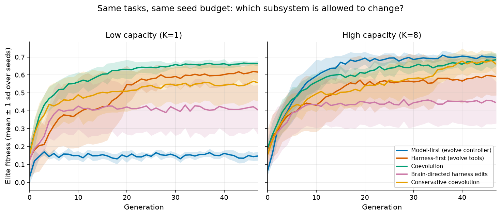
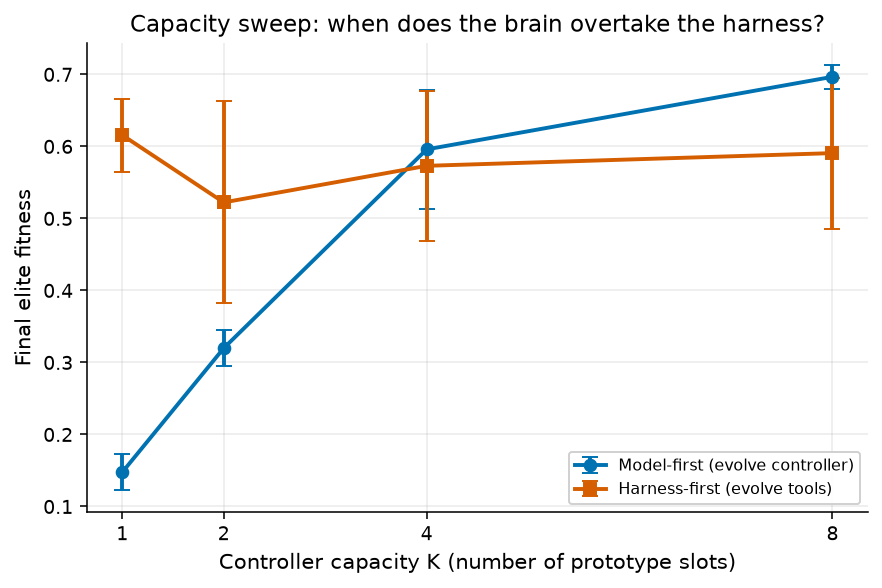

# Does the harness evolve first, or the model?

**This is a synthetic evolutionary simulation, not a user study and not a test of a real LLM.**

Recorded run: 8 seeds (`0`–`7`), 48 generations, population 32, same evaluation budget in every cell. Raw numbers in `results/summary.json`.

## Result

In this toy, **the harness evolves first while the brain is primitive; past a capacity threshold the brain takes over.** A greedy brain that edits the tool it thinks is worst can lock in a worse limb than blind selection keeps.

| Hypothesis | Held? | Recorded number |
| --- | --- | --- |
| **H1** Tight controller budget: evolving the harness beats evolving the controller | **Yes** | At `K=1`, harness-first elite fitness **0.616 ± 0.051** vs model-first **0.148 ± 0.025** |
| **H2** Past a capacity threshold, growing the controller beats growing the harness | **Yes** | At `K=8`, model-first **0.697 ± 0.017** vs harness-first **0.591 ± 0.105**. The sweep crosses between `K=2` and `K=4`. |
| **H3** Blind tool selection beats a myopic brain editor on a delayed-reward task | **Yes** | At `K=8`, deceptive score **0.981 ± 0.182** (blind) vs **0.677 ± 0.189** (brain-directed). Key-tool retention **0.375** vs **0.000**. |
| **H4** Coevolution reaches higher fitness but churns tools unless selection is conservative | **Partly** | At `K=1`, coevolution **0.664** beat both singles. At `K=8` it did not beat model-first (**0.685** vs **0.697**). Turnover was higher than conservative selection (**0.122** vs **0.079** at `K=8`). |

Fitness is mean ± 1 sd over 8 seeds (elite mean of the top 8 individuals). Details, caveats, and the exact protocol: [`docs/experiment.md`](docs/experiment.md). How this maps onto Sims, Brooks, Toolformer, Voyager, and morphological computation: [`docs/literature.md`](docs/literature.md).





## What this is

An agent is a **capacity-limited controller** (the “brain”) sitting in a **harness** of tools and sensors (the “limbs”). Each tool has a cost, a capability, and a failure rate. Fitness = expected task success − harness cost − a spam penalty, so “add every tool” is not free.

Five regimes, same tasks, same seed budget:

1. **Model-first** — freeze a complete field kit, mutate the controller.
2. **Harness-first** — freeze a capacity-capped controller, mutate tools and sensors.
3. **Coevolution** — mutate both.
4. **Brain-directed harness edits** — a myopic value estimate chooses which installed tool to mutate, and selection uses that same short-horizon score.
5. The same comparison on a **deceptive / delayed-reward** task, where the tool that looks worst on common steps is the one that pays on the rare jackpot.

Two capacity regimes (`K=1` primitive, `K=8` enough slots to specialize) plus a sweep at `K=2,4`.

Tasks are synthetic: foraging with partial sensing, a contextual tool-choice bandit, and a delayed-reward landscape. There is no network, no API key, and no language model.

## Reproduce

```bash
python3 -m venv .venv
source .venv/bin/activate
pip install -r requirements.txt
python -m sim.run
```

Smoke test (tiny seed budget, **not** the recorded result):

```bash
python -m sim.run --smoke
```

Outputs (overwritten by each full run):

- `results/summary.json`
- `results/fitness_vs_generation.png`
- `results/capacity_sweep.png`
- `results/tool_turnover.png`
- `results/key_retention.png`
- `results/harness_vs_brain.png`

Requires Python 3.10+ and the pins in `requirements.txt` (`numpy`, `matplotlib`). Offline after install.

## Layout

```
sim/                 # numpy evolution + matplotlib
docs/literature.md   # map onto verified papers
docs/experiment.md   # protocol + numbers from this run
results/
LICENSE              # MIT
```

## License

MIT. See `LICENSE`.
